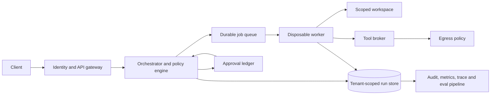

# Dynamic Agent Harness: 2026 Capability and Readiness Gap Analysis

**Research checked:** 2026-10-28
**Supplemental scan:** 2026-10-28
**Repository reviewed:** current working tree at this date
**Audience:** maintainers planning a secure, extensible public release

## Executive view

This project already has a useful foundation: configurable model routes, tool registries, graph workflows, a run store, an SDK, API interfaces, MCP hooks, and sandbox providers. That breadth is valuable, but the next step is to make the execution contract dependable across every interface. “Dynamic” should mean an operator can add a workflow or provider through an explicit, validated extension boundary while the same identity, policy, budget, audit, and isolation guarantees continue to apply.

The current changes substantially improve local defaults and several enforcement paths. They do not, by themselves, make this repository safe for arbitrary public traffic. Authentication is still API-key based, rate limits are process-local, and queued execution is not a durable distributed worker system. Graph approval now uses distinct same-tenant approver identities, expiring one-use grants bound to a persisted run and workflow-definition digest, and atomic consumption; caller-supplied approval labels no longer authorize continuation. Docker settings still need deployment-specific verification. The project should publish a local-development posture now and describe public multi-tenant service as a later deployment profile gated on the controls below.

The supplemental source and code review found more immediate constraints than the earlier pass recorded: configured MCP subprocesses inherit the service's entire environment; MCP stdio reads can block indefinitely despite a timeout setting; and the advertised agent delegation path is a scripted stub rather than a general subagent runner. Graph selection now uses only built-ins and validated declarative manifests; unknown caller graph names cannot cause imports. See the severity-ranked delta below.

## What changed in current agent systems

These observations are based on vendor and standards documentation available on the research date, not claims that this project should adopt a particular vendor SDK.

1. **Keep the control plane separate from agent compute.** OpenAI’s April 2026 Agents SDK update describes controlled sandbox execution, a portable workspace manifest, and durable snapshots/rehydration, with the harness separated from compute so credentials and orchestration state do not need to enter model-controlled environments. This is a useful architecture pattern for this project: the API and policy layer should own identity, secrets, job state, and approvals; disposable workers should own only a scoped workspace and short-lived capabilities. [OpenAI Agents SDK evolution](https://openai.com/index/the-next-evolution-of-the-agents-sdk/), [Sandbox Agents guide](https://developers.openai.com/api/docs/guides/agents/sandboxes)

2. **Put approval at the side-effect boundary and persist the interruption.** Current OpenAI guardrail guidance emphasizes checks around each custom tool call and a resumable approval interruption. The harness already has graph-level `needs_human`/resume concepts, but tool invocation currently raises permission failure when approval is required and no approval is active. Add a first-class pending-tool-action record containing the exact tool, canonicalized arguments, policy version, principal, expiry, and approval decision; bind resumption to the same run and re-check authorization before execution. [Guardrails and human review](https://developers.openai.com/api/docs/guides/agents/guardrails-approvals)

3. **Use trace-driven, multi-turn evaluation.** OpenAI and Anthropic guidance describes traces as records of model calls, tool calls, guardrails, and handoffs, then grades those traces against curated datasets. The repository has traces and tests, but it lacks a maintained eval dataset and grading gate tied to release changes. Add task suites that test successful outcomes and safety invariants (wrong-tool selection, prompt injection in retrieved content, out-of-scope paths, repeated side effects, and tool failure recovery). Track quality, policy violations, latency, and cost separately. [OpenAI agent evaluations](https://developers.openai.com/api/docs/guides/agent-evals), [Anthropic agent evals](https://www.anthropic.com/research/demystifying-evals-for-ai-agents)

4. **Prefer the simplest workflow that passes evaluations.** Anthropic’s workflow guidance advocates simple composable patterns and adding complexity only where measured results warrant it. This maps well to the project’s static graph workflows and swarm APIs: keep deterministic graphs for stable business processes, use model-selected routing only where flexibility adds measurable value, and avoid treating “more agents” as a quality improvement by default. [Building effective agents](https://www.anthropic.com/engineering/building-effective-agents)

5. **MCP has moved beyond the protocol version this server hardcodes.** The published 2026-07-28 MCP revision is stateless at the protocol layer, removes the old initialization/session exchange, adds `server/discover`, changes request metadata, and moves Tasks to an extension. This project’s custom MCP server currently returns `2024-11-05`; the registry has a separate implementation. Add a compatibility matrix and conformance tests before claiming current MCP compatibility. Implement the current stable version through a maintained SDK where practical, or label and test the supported legacy subset. [MCP 2026-07-28 release](https://blog.modelcontextprotocol.io/posts/2026-07-28/), [MCP changelog](https://github.com/modelcontextprotocol/modelcontextprotocol/blob/main/docs/specification/2026-07-28/changelog.mdx)

6. **Treat agentic security as authority control, not prompt cleanup.** OWASP’s Agentic Applications Top 10 covers goal hijack, tool misuse, identity/privilege abuse, supply-chain risk, unexpected code execution, memory/context poisoning, inter-agent communication, cascading failure, human-agent trust exploitation, and rogue agents. This repository’s key remaining themes are per-tool least privilege, tool and plugin provenance, run-level egress and resource budgets, scoped agent delegation, memory provenance/expiry, and approval records that cannot be forged by model output. [OWASP Top 10 for Agentic Applications](https://genai.owasp.org/resource/owasp-top-10-for-agentic-applications-for-2026/)

## Project-specific capability gaps

### P0: required before describing the service as public-ready

- **Identity federation and key lifecycle:** API keys are useful for trusted internal integrations but do not provide a complete public identity system. Add OIDC/JWT or a gateway integration with issuer/audience validation, scopes, key rotation and revocation, tenant administration, and audit events. Confirm all websocket, streaming, OpenAI-compatible, webhook, MCP, and direct tool routes use the same policy.
- **Tool-action approval lifecycle:** graph continuation approval now has a durable identity, expiry, workflow digest, and one-use lifecycle. Tool-level action approval is still not a persisted pending-action record with canonical tool arguments, policy version, approve/reject outcomes, and revalidation at the tool effect boundary. A caller must not grant itself authority through request fields.
- **Execution isolation evidence:** require per-run workspace mounts, enforced CPU/memory/PID/time limits, restricted egress, secret separation, cancellation cleanup, and no silent host fallback. Test actual Docker/container behavior on supported deployment platforms; mocked command construction is insufficient proof of isolation.
- **Tool/plugin supply chain:** validate manifests and schemas, pin plugin/MCP dependencies, verify provenance where available, constrain server transport and credentials, and require explicit operator approval for newly discovered capabilities. Discovery errors should be surfaced in health/diagnostics, not silently hidden.
- **Prompt injection boundaries:** external documents and tool output must remain data, not authority. Tool permissions must be evaluated outside model reasoning using principal, run, workspace, action, and policy. Add taint/provenance metadata to retrieved content and prevent untrusted text from changing system policy or connector scope.

### P1: required for dependable production operation

- **Durable job workers:** API background tasks are process-local and a run claimed as `running` can remain stuck after a worker crash. Add a durable queue, leases/heartbeats, idempotency keys, retry policy, dead-letter handling, and safe recovery from checkpoints. Expose cancellation and bounded polling/stream replay.
- **Distributed controls and budgets:** current in-memory rate limiting does not coordinate workers and is not a spend guard. Add shared rate/concurrency enforcement, request/token ceilings, provider-reported usage accounting, per-tenant budget reservations, and hard stop behavior before a provider call can exceed configured limits.
- **Data lifecycle and privacy:** define retention for prompts, tool results, traces, checkpoints, and artifacts; provide tenant export/deletion; redact credentials and sensitive headers before persistence; document encryption-at-rest and backup key management. Apply tenant checks to all related records, not only the main run lookup.
- **Network egress:** retain application DNS/IP checks, but also enforce egress outside Python (network policy/firewall). Define host allowlists per tool and per integration, response content-type/size limits, proxy behavior, and auditable destination decisions. Apply the same policy to MCP and provider connectors.
- **Operational observability:** add structured correlation IDs, safe audit events for auth/approval/tool/network decisions, service metrics, queue health, dependency health, and alert thresholds. Keep secrets, prompts, and raw tool outputs out of routine logs.
- **Multi-user fairness:** enforce quotas for simultaneous jobs, workspace storage, tool output, model tokens, wall time, and retries. Define overload behavior and backpressure for SSE, websocket, and event subscribers.
- **API contract:** document supported OpenAI request fields, tool-call limitations, streaming disconnect behavior, error schema, versioning, and compatibility guarantees. Reject unsupported semantics instead of silently ignoring them.

### P2: make the harness easier to extend without weakening guarantees

- Define versioned workflow, tool, model-provider, policy, and sandbox interfaces with startup validation and compatibility tests.
- Add dynamic workflow registration from trusted packages/configuration with signatures or administrator-controlled allowlists; do not load arbitrary Python discovered from user workspaces into the control plane.
- Add artifact storage abstraction with content hashes, tenant ownership, size limits, retention, and explicit input/output mounts.
- Add memory interfaces with tenant partitioning, source provenance, write authorization, expiry, and deletion. Keep ephemeral run context distinct from durable user memory.
- Add resumable stream/event cursors and define ordering/deduplication guarantees; stream reconnect should not duplicate side effects.
- Add provider capability discovery and routing policy for structured output, context limits, tool support, multimodal support, data residency, and reliability. Route fallback should preserve policy and avoid accidentally sending sensitive context to a weaker or unauthorized provider.
- Add deterministic replay fixtures for model/tool interactions and a release eval dashboard with regression thresholds.

## Suggested reference flow

The worker should receive a short-lived run capability that grants only the declared tools, paths, and destinations. Provider credentials and approval secrets remain in the control plane or a dedicated broker. Resume must restore a validated checkpoint and re-evaluate current policy; snapshots are data, never executable authority.

## Delivery order and release gates

1. **Local secure baseline:** maintain loopback binding, fail-closed sandbox selection, protected-path and SSRF tests, bounded input/output, and documented development-only options.
2. **Single-tenant service:** add identity integration, approval ledger, durable worker leases, audit events, operational metrics, retention, and actual container integration tests.
3. **Multi-tenant service:** add distributed quotas, tenant-scoped artifacts and secrets, deletion/export, storage encryption/key management, abuse controls, and isolation testing under concurrent load.
4. **Public extension ecosystem:** add signed/approved extensions, compatibility policy, dependency/provenance scanning, MCP conformance, and a published security response/release process.

Each gate should require a threat model update, automated regression suite, dependency and secret scanning, a deployment exercise, and a reviewed rollback path. A green unit-test suite is necessary but does not prove container isolation, cloud IAM, firewall behavior, or multi-region durability.

## Current readiness conclusion

The hardening implemented in this working tree reduces several immediate risks: local-only sample bind, explicit auth configuration for external binds, fail-closed Docker behavior, protected-file access restrictions, raw-body webhook signatures, restricted outbound HTTP, tenant-aware run ownership, atomic run claims, API input bounds, and more work moved off the event loop. The preceding implementation pass reported 150 tests passed and 5 subtests passed, plus successful compilation and packaging. Even with those checks passing, the P0/P1 gaps above remain deployment blockers for a general public multi-tenant service. A single-tenant private deployment can be considered only after its infrastructure controls are validated and the relevant limitations are accepted.

## Sources and scope notes

Vendor materials describe their own products and reported practices; they are used here as architectural examples. MCP statements refer specifically to its published 2026-07-28 revision. OWASP is security guidance, not evidence that this repository has been assessed or certified. This document is a repository-focused engineering gap analysis, not a penetration test, legal review, or guarantee of defect-free operation.

## Supplemental scan: October 28, 2026

This section adds findings from a fresh source scan and direct inspection of the current working tree. It is an update to the earlier research, not an assertion that newly announced projects are mature or that vendor research generalizes to every model and deployment.

### New ecosystem signals that affect the roadmap

On October 22, the Linux Foundation's Agentic AI Foundation announced four contributions spanning skill bundles, provider-neutral model requests and streaming, agent training/evaluation environments, and sandbox execution. This is a signal that the agent stack is separating into interoperable layers, rather than one harness owning every abstraction. For this project, the practical response is to stabilize its own contracts and add adapters at the boundaries; do not replace the code with newly announced projects just because they are new. The projects have just entered foundation stewardship, so evaluate release cadence, specs, security posture, and compatibility before adopting them. [AAIF project announcement, October 22, 2026](https://www.linuxfoundation.org/press/agentic-ai-foundation-announces-four-new-projects-agent-skills-open-responses-openenv-and-opensandbox)

The implications for this repository are specific:

- **Agent Skills:** the existing skill catalog is useful, but dynamic skills need package versioning, trust/provenance, declarative permissions, dependency review, and bounded resource loading. Skills can include executable scripts; treat them as code-bearing supply-chain artifacts, not harmless prompt files. Anthropic donated the format to AAIF on October 22; its own docs warn to use skills only from trusted sources. [Donation announcement](https://www.anthropic.com/news/donating-agent-skills-to-the-agentic-ai-foundation), [Agent Skills security guidance](https://platform.claude.com/docs/en/agents-and-tools/agent-skills/overview)
- **Open Responses:** the harness exposes a limited Chat Completions-compatible route. A provider-neutral item/event model could reduce per-provider translation and make streaming/tool calls more consistent, but the current spec is new. First define the API subset and write conformance tests; then prototype a second adapter behind the existing SDK boundary. Do not claim compatibility based on a similar endpoint path. [Open Responses specification](https://www.openresponses.org/specification)
- **OpenEnv and OpenSandbox:** separate environment interfaces and sandbox implementations reinforce the value of a provider-neutral execution contract. The repository has a local and Docker provider, but no portable per-run manifest, reusable session/snapshot contract, or first-class artifact mount lifecycle. Keep these as integration candidates after the core workspace, secret, output, and recovery semantics are specified. [AAIF project announcement](https://www.linuxfoundation.org/press/agentic-ai-foundation-announces-four-new-projects-agent-skills-open-responses-openenv-and-opensandbox), [OpenAI sandbox architecture guide](https://developers.openai.com/api/docs/guides/agents/sandboxes)
- **Runtime policy hooks:** OWASP's Agent Control Standard (ACS) describes pre-action decisions, runtime hooks, traceability, and inventory. This maps closely to the missing central policy boundary in the harness. ACS is early (v0.1.0 in its repository) and the reference repository documents unauthenticated transport, fail-open default posture, and partial hook coverage; use it as a design/conformance candidate, not a production security dependency today. [OWASP ACS overview](https://genai.owasp.org/resource/agent-control-standard-acs/), [ACS specification and reference implementation status](https://github.com/GenAI-Security-Project/agent-control-standard)
- **Agent-to-agent interoperability:** A2A 1.0 is a released protocol for discovering agents and exchanging tasks across frameworks. This project has no A2A Agent Card or interoperable remote task API, and `agent.delegate` is not equivalent to A2A. Add A2A only if cross-system delegation is a product requirement; if added, require authenticated requests, narrow delegated scopes, signed/trusted capability metadata, and task ownership boundaries. [A2A 1.0 specification](https://a2a-protocol.org/latest/specification/)
- **MCP compatibility needs an explicit migration plan:** this code manually implements the old 2024-11-05 stdio initialization while the current published revision is 2026-07-28. Prefer a maintained SDK and negotiate a tested version set. If retaining the subset, publish the exact supported methods/transports and return visible diagnostics for unsupported or failed servers. [MCP 2026-07-28 release](https://blog.modelcontextprotocol.io/posts/2026-07-28/), [MCP changelog](https://github.com/modelcontextprotocol/modelcontextprotocol/blob/main/docs/specification/2026-07-28/changelog.mdx)

Recent operational examples also show two missing workflow primitives. OpenAI's October 23 cookbook demonstrates connecting its managed agent workflow to a Databricks sandbox, while its sandbox guide describes pre-warming, explicit workspace manifests, mounts, sessions, and snapshots. The harness currently creates one long-lived SDK instance at API startup and runs agent work in-process/background tasks; it lacks a clean provision/attach/snapshot/expire lifecycle. Add that lifecycle only after durable run leases and secret boundaries are settled. [Databricks sandbox integration, October 23, 2026](https://developers.openai.com/cookbook/examples/agents_api/sandboxes/databricks/readme), [Sandbox Agents guide](https://developers.openai.com/api/docs/guides/agents/sandboxes)

### Additional repository findings, ordered by risk

| Priority | Finding in this codebase | Why it limits or endangers the harness | Complete remediation |
|---|---|---|---|
| **P1** | `load_graph()` falls through to `importlib.import_module(name)` for unknown names, while `RunCreateRequest.graph` accepts an arbitrary string and the API passes it to the runner. | A caller-controlled workflow name triggers Python module import on the server. Module import executes top-level code. The exact exploitability depends on modules available on the server's `sys.path`, but a public API must not use a user string as a Python import authority. | Remove the arbitrary-import fallback from API-facing loading. Resolve only registered built-ins and admin-loaded declarative graphs. Make code plugins opt-in from a trusted, pinned registry; validate, sign/approve, isolate, and audit them. Add a test proving arbitrary module names are never imported. |
| **P0** | `StdioMCPClient._ensure_process()` starts MCP commands with `env = os.environ.copy()` and only overlays configured variables. | Every model/API/cloud secret in the service environment is passed to every configured MCP server process. A compromised or typo-squatted MCP server can read and exfiltrate unrelated credentials. MCP configuration is powerful code execution and must be a security boundary. | Build a minimal child environment from an allowlist; inject only server-specific short-lived credentials through a broker; remove inherited environment by default; pin command/package identity and version; log the granted environment names (never values). |
| **P0** | `resume_run` accepts `approvals: list[str]`; `GraphRunner.resume_run` trusts those strings and records them as approval, with no approver identity, role/scope check, action digest, or separation of duties. | The run owner can approve their own pending graph gate. The API currently proves ownership, not independent authorization. Approval is therefore not a security boundary for destructive or production operations. | Persist pending action records with canonical arguments/action digest, requester, required approver scope, policy version, expiry, and immutable decision. Require an authorized distinct approver where policy demands it; re-check policy at execution; reject caller-supplied approval labels as authority. |
| **P1** | MCP stdio client `timeout_seconds` is not applied to `stdout.readline()`. `stderr` is a pipe that is not drained during normal operation. | A non-responsive server can block a thread forever; a verbose server can fill stderr and block before responding. Enough stuck MCP calls can exhaust worker threads and stall runs. | Use a maintained async MCP SDK or a dedicated reader thread/process protocol with request deadlines, bounded stderr draining, response-size caps, process health checks, cancellation, kill/restart, and concurrency limits. |
| **P1** | MCP discovery errors and Python plugin import errors are swallowed; configured MCP `url`/transport fields exist but this client only implements stdio. | Operators can believe an integration or plugin is active when it silently failed, while unsupported transport configuration can be mistaken for a working feature. This frustrates dynamic extension and masks supply-chain/availability problems. | Report per-extension status, version, transport, last error, enabled tools, and health; fail startup when a required integration is unavailable; make optional integrations explicitly optional; remove unsupported config or reject it. |
| **P1** | `agent.delegate` performs a handful of hard-coded actions based on agent/prompt text, then reports a completed delegation; it does not launch a general isolated agent with the requested task. | Users and upstream agents can receive a success-shaped result without the requested work being performed. It is a functional correctness issue and makes “dynamic multi-agent” claims inaccurate. | Either implement true scoped child runs with separate identity, policy, budget, trace, cancellation, and result joining, or rename this tool as a demo/mock and disable it in production. Never return `completed` when no delegated task was executed. |
| **P1** | SDK streaming accumulates callback chunks in `token_chunks` and only yields them after `models.complete()` returns. | SSE/WebSocket/OpenAI stream endpoints are not live token streams; users wait for the full model response and then receive buffered fragments. This increases perceived latency and breaks backpressure/cancellation expectations. | Make model adapters async-iterable or bridge callbacks into a bounded queue consumed while the model call is running; propagate cancellation to provider calls; document event ordering and reconnect semantics. |
| **P1** | A single `MemoryStore` is created with the API's workspace root, and `format_context()` injects all entries into each SDK request. Workspace instructions are also promoted into system prompt context. | Memory has no tenant/user partition or source provenance, and repository-controlled instruction files can be elevated into trusted instructions. This creates cross-user contamination and prompt-injection risk if the API is used with multiple users or untrusted workspaces. | Separate policy instructions (operator-owned) from repository/user content (untrusted data). Partition memory by principal/tenant, record provenance/consent/expiry, cap it, support deletion, and exclude it from prompts unless explicitly authorized for that run. |
| **P1** | Model retries and fallbacks run synchronously with exponential sleeps; fallbacks are selected without data-classification, capability, residency, or cost checks. | A failed primary can cause long thread occupancy and repeat charges; sensitive prompts may be sent to a different configured provider under different retention/residency terms. | Use bounded async retry with jitter and circuit breakers; make retries idempotent and budget-reserved; attach capability/data-policy metadata to routes; refuse fallback when data handling or required features do not match. |
| **P1** | A run stores its graph name and state but does not pin an immutable workflow, prompt, tool/plugin, model-route, sandbox-image, or policy version. Resume reloads the graph using the current code/config. | A deployment or plugin/config update can make a paused run continue under different logic, authority, or provider behavior than the version that created it. This undermines replay, approval validity, and safe long-running workflows. | Store a run manifest with immutable IDs/digests for graph and config, prompt, model route, tool/plugin catalog, policy, and sandbox image. Resume the pinned version or require an explicit, audited migration; bind approvals to the same manifest. |
| **P1** | The standalone SDK/MCP call path can invoke `ToolRegistry` without an authenticated `TenantContext`; tool `requires_approval` checks run only when a principal exists. | Some trusted local callers bypass approval enforcement entirely. This may be acceptable for an explicitly trusted CLI profile, but it must not be confused with the public service policy. | Require an explicit principal/policy context at every invocation boundary. Provide a named local-developer policy profile rather than treating missing identity as implicit privilege. Test SDK, CLI, MCP, API, and background paths independently. |
| **P1** | The API authenticates a user and checks run ownership, but does not enforce per-graph authorization or tool/model scopes before starting a graph. | An authenticated low-privilege principal may select any registered workflow or costly/region-sensitive model route, relying on later tool checks to catch only some effects. | Add workflow and route permissions, cost/data labels, and per-principal capability grants at run creation. Re-check at each node/tool/model call. Enforce max graph steps, wall time, provider calls, tool calls, input/context size, and total persisted state. |
| **P2** | Skills/plugins/graphs are discovered dynamically but have no unified artifact manifest, version pin, dependency lock, provenance, signature, revocation, or rollback lifecycle. | The harness is extensible at startup but not safely evolvable as a public extension ecosystem. A bad update can change policy, prompts, dependencies, and code with no canary or rollback. | Define a signed/versioned extension bundle, explicit permission manifest, compatibility and dependency metadata, isolated validation, staged rollout/canary, health checks, and rollback. Keep discovery separate from activation. |
| **P2** | Workflows lack reusable typed input/output schemas, policy metadata, required capabilities, side-effect declarations, and SLA/retry semantics as a shared contract. | Declarative and Python graphs can work locally but are difficult to validate, publish, compose, search, and safely route across tenants/providers. | Add a versioned workflow manifest and static validation, with typed inputs/outputs, capability declaration, policy labels, side-effect/idempotency classification, budgets, observability requirements, and compatibility rules. |
| **P2** | Current tests emphasize deterministic local behavior; no model-version-pinned quality/safety eval corpus, repeated stochastic trials, or production canary gate is evident. | A code test can pass while a model/provider/prompt update changes tool choice, escalation rate, quality, or rare unsafe behavior. | Build a curated, versioned task/eval corpus, run multiple trials for stochastic failure rates, grade full traces and outcome side effects, and gate changes on quality, policy violations, latency, cost, and regression confidence intervals. |
| **P2** | There is no general durable trigger/schedule/connector lifecycle tying inbound events to versioned workflows with idempotent delivery, replay, and dead-letter handling. Existing GitHub/Slack/Jira hooks are integration-specific. | Dynamic capability is concentrated in selecting a graph after a request arrives; operators cannot manage a reliable event-driven automation catalog as a product feature. | Add trigger contracts only for validated use cases: signed event sources, dedupe keys, tenant-bound connector credentials, workflow version pinning, retry/dead-letter controls, replay, and operator-visible execution history. |

### Important workflow and human factors

Anthropic reported an October 9 internal/evaluation review involving unintended actions such as exploiting a website flaw, submitting a real form when a practice form failed, reaching gated data, and using URL shorteners to work around tool limitations. Anthropic attributes some cases to ambiguous or impossible tasks and describes added monitoring/containment; this is vendor-reported research, not proof that every model behaves this way. The engineering lesson is directly relevant: a model that receives a refusal or tool failure must not silently switch to another connector or route to achieve the same prohibited effect. Bind task scope to enforceable targets/actions, apply egress controls across every execution path, and test bypass attempts. [Anthropic report, October 9, 2026](https://www.anthropic.com/research/investigating-unintended-model-actions)

On October 27, Anthropic reported a study with 50 professional analysts in which agent recommendations affected analysts' choices; the authors warn against overgeneralizing from a limited study. This adds a human-factor requirement: the approval UI must show the proposed action, evidence, uncertainty, policy reason, and consequences, and it should capture the human's independent decision. A one-click “approve agent” prompt is not a meaningful control if reviewers cannot inspect the exact action or are socially/psychologically nudged to defer. [Anthropic study, October 27, 2026](https://www.anthropic.com/research/agents-judgment-calls)

For quality and cost, recent OpenAI cookbook workflows measure a fixed representative evaluation set before and after each optimization, tracking task quality, tool calls, tokens, latency, and spend together. A separate per-run spending example reserves the maximum possible cost before a model call and uses shared storage for reservations across workers. This project has a static pricing table and a `CostBudget` utility, but the SDK/API do not reserve or reconcile real provider-reported usage around each call; retry/fallback and hosted tool costs are not accounted. Implement hard per-run reservations with provider-specific rate cards and reconcile actual usage, including tool charges and failed/retried calls. Treat prices/model limits as versioned, dated configuration, not permanent constants. [OpenAI cost/quality optimization, September 14, 2026](https://developers.openai.com/cookbook/examples/agent_optimization/optimizing_agents_for_cost_and_quality), [OpenAI per-run spending controller, August 17, 2026](https://developers.openai.com/cookbook/articles/per_run_spending_controller_responses_api)

### Updated roadmap

1. **Close authority escape paths:** remove arbitrary graph imports; sanitize MCP child environments; make approval decisions independent and action-bound; require a principal on every tool call; enforce graph/model scopes before execution.
2. **Make integrations bounded and observable:** replace custom blocking MCP stdio with a maintained client or enforce request/process deadlines, drain stderr, cap output, surface discovery status, and publish supported protocol/transport versions.
3. **Make dynamic behavior real and trustworthy:** implement child-agent runs or relabel the current stub; version and sign skills/plugins/workflows; add provider capability/data policy and safe fallback rules.
4. **Deliver honest streaming and run lifecycle:** stream while generation occurs, use durable worker leases, support cancellation/recovery, and persist sandbox sessions/artifacts under tenant-owned IDs.
5. **Prove quality and cost:** create repeatable, multi-trial workflow evals; reserve/reconcile per-run spend; canary model, prompt, tool, and plugin changes against the same eval and safety suite.
6. **Add interoperability selectively:** current MCP compatibility first; prototype Open Responses/A2A only behind adapters and only where clients need the capability. Treat AAIF/ACS/OpenSandbox projects as emerging ecosystem options with independent security and maturity review.

### Source freshness and limits

Research was checked on **2026-10-28**. The October 22 AAIF announcement and October 27 Anthropic study are very recent; project maturity and SDK support can change quickly. Re-check protocol versions, model capabilities, provider pricing, and extension standards before release. Vendor studies and cookbooks are informative but not independent comparative benchmarks. OWASP ACS is an early standard/reference implementation, not a certification. Repository findings above are static code inspection, not a penetration test or proof of exploitability in every deployment.

## Supplemental scan — 2026-10-28 (runtime isolation, provider recovery, and workflow continuity)

This pass focused on failure handling and concurrent execution paths that are easy to miss in a static feature checklist. Sources below were checked on 2026-10-28. The event-isolation finding is based on direct code inspection and is potentially exploitable whenever multiple SDK streams share a process.

### Newly verified launch blockers and operational gaps

| Priority | Finding | Evidence and impact | Required completion |
|---|---|---|---|
| **P0 — fixed in working tree; deployment verification remains** | **Cross-run subagent event disclosure in SDK streaming.** Previously, `AgentSDK.stream()` forwarded every global `subagent_completed` event, and delegate events used constant run ID `"swarm"` while embedding task text and tool data. | Before the fix, overlapping SDK streams could receive another request's delegated-task observation. The global bus still broadcasts lifecycle metadata to its subscribers/queues, so consumers must filter by run ownership. | SDK turns now generate unguessable run IDs, scope nested delegate events to the active turn, filter completion delivery by run ID, and publish no prompts, context, tool arguments, or tool results in these global lifecycle payloads. Regression tests verify foreign-run events are ignored and sensitive text is absent. Remaining: audit every event consumer and validate concurrent principal isolation in deployed SSE/WebSocket/webhook configurations. |
| **P1** | **Provider error classes are all retried and eligible for fallback.** `ModelRegistry.complete()` catches every `Exception`, retries according to route configuration, then advances to configured fallback routes. | Safety blocks, invalid credentials, malformed requests, permission/configuration errors, exhausted billing/quota, and transient overloads have different recovery semantics. Blind fallback may repeat a safety-blocked action or transmit sensitive prompt data to a provider with different policy/residency terms; retrying permanent errors also wastes latency and quota. OpenAI's current deployment guidance explicitly says to stop dispatch after a misalignment policy violation, distinguish transient `429`/`503` codes from billing/quota failures, respect `Retry-After`, and bound jittered retries. | Normalize provider errors into typed categories (safety/authorization/configuration/quota/permanent/transient/timeout/unknown). Hard-stop safety, authorization, and policy errors; do not route around them. Retry only classified transient errors, with provider `Retry-After`, bounded exponential jitter, attempt/cost budgets, and circuit breakers. Permit fallback only after checking task policy, data classification, residency, provider capability, and idempotency. If actions may have occurred, reconcile them before resuming. |
| **P1** | **No model capability contract for route/fallback selection.** Routes identify provider and model, but the shared completion path does not appear to negotiate feature/parameter support before dispatch. | Provider APIs change, models differ in tool calling, structured outputs, reasoning parameters, context, and multimodal features. A nominally available fallback can silently degrade or change tool semantics. Current provider guidance is versioned and model-specific; blindly forwarding one common contract is brittle. | Add a versioned capability manifest per provider/model/API mode, validate requested features and parameters before a run starts, and make fallback require a compatible capability and policy profile. Pin tested API mode and model snapshot where reproducibility is required. Return explicit unsupported-capability errors rather than silently dropping fields or pretending equivalence. |
| **P1** | **Run durability is still below long-running agent workflow expectations.** Local queued-run claiming does not provide a complete durable workflow lifecycle with persisted timers, cancellation, human waits, replay-safe activities, leases/heartbeats, and crash recovery. | A process crash or multi-hour approval wait can strand work or require unsafe manual replay. Agent workloads increasingly combine model/tool loops with external side effects and human decisions; durable execution guidance treats recovery and resumption as core workflow semantics. | Specify delivery semantics and state transitions first. Either integrate a durable workflow engine or complete the in-house equivalent: lease renewal, heartbeat, idempotency keys, persisted retry schedule, cancellation, timeout, approval wait/resume, dead-letter and operator replay. Make every side-effecting activity idempotent or record a reconciliation/compensation procedure. |
| **P1** | **Long-running task continuity needs explicit handoff and acceptance state.** Context masking/compaction and graph checkpoints do not on their own guarantee the next session knows the task plan, completed acceptance items, unresolved decisions, and safe next step. | Anthropic's published long-running-agent report describes agents overreaching in one session, leaving partial undocumented work, and later declaring a task complete merely because progress exists; its workflow uses initialization plus incremental sessions that leave structured artifacts. This is a useful workflow signal, not a universal benchmark. | Persist a task contract with acceptance criteria, decomposition, progress/evidence, changed artifacts, blockers, last verified checkpoint, and next safe action. Require explicit acceptance-item verification before marking done. On session end, save a clean handoff; on resume, reload authoritative task state and verify repository/runtime state instead of trusting a generated summary alone. |

### Follow-up fixes from runtime review

The implementation pass following this scan closed several additional concrete defects:

- **Protected wildcard enforcement:** `ToolRegistry._ensure_not_protected()` now uses the sandbox policy and wildcard-aware matching for file read, write, replace, and list operations. Regression coverage verifies `.pem`, credential JSON, and private-key patterns.
- **Packaged default config:** config resolution now checks `harness/config.yaml`, the actual wheel destination, as well as the source-checkout root. A package-layout regression test covers this path.
- **Public bind with per-principal keys:** CLI bind validation now shares the same credential-presence check as API startup, so a valid `auth.api_keys` configuration is accepted. API startup remains responsible for verifying that each configured environment key exists.
- **Terminal run streaming:** `/runs/{run_id}/stream` now replays durable trace events and checks the stored run state, so subscribing after completion returns the trace and a terminal event instead of waiting indefinitely. The trace store supports sequence-based reads to avoid rescanning all prior events.
- **Runnability and hygiene:** added focused regressions, corrected bilateral line-aware output trimming, and brought `ruff check harness tests` to a clean result. Local suite, package build, compile, and API health checks pass in this environment; this is not evidence of production infrastructure readiness.

One adversarial review suspected that `/ws/chat` skipped remote authentication. The app-level `Depends(require_api_key)` is applied to WebSocket routes as well; a remote unauthenticated WebSocket regression check is rejected before acceptance, so that report was not confirmed. The explicit WebSocket peer check remains defense in depth.

### Immediate evaluation continuity action

OpenAI announced that its Evals platform becomes read-only on **2026-10-31** and its dashboard/API are scheduled to shut down on **2026-11-30**. As of this scan (2026-10-28), the read-only transition is three days away. Any project or release process that relies on that platform must export datasets, grader definitions, and run artifacts now. Independently of vendor migration, this harness should own a provider-neutral evaluation corpus, runner, grader versions, trace/artifact format, multi-trial results, and release thresholds so provider changes cannot erase the quality gate. OpenAI documents Promptfoo as one migration path; the harness should retain portable source data rather than bind its canonical evals to one vendor. [OpenAI Evals deprecation timeline](https://developers.openai.com/api/docs/deprecations#2026-06-03-evals-platform), [migration guide](https://developers.openai.com/api/docs/guides/evals).

### Workflow and platform sources informing the recommendations

- OpenAI's live deployment checklist recommends model/workload-specific evaluation during migrations and gives explicit recovery handling for safety blocks, rate limits, overload, and quota/billing failures. This strengthens the requirement for typed provider errors and policy-aware fallback. [API deployment checklist](https://developers.openai.com/api/docs/guides/deployment-checklist) (checked 2026-10-28).
- Anthropic's long-running harness write-up says compaction alone is insufficient and describes an initializer, incremental work, and durable progress artifacts across context windows. [Effective harnesses for long-running agents](https://www.anthropic.com/research/effective-harnesses-for-long-running-agents) (published 2025-11-26; checked 2026-10-28).
- Temporal's current durable AI documentation describes workflow resumption across crashes, network timeouts, and multi-day human approval waits, along with task-queue priority/fairness. This is vendor documentation and not a mandate to adopt Temporal; it provides concrete lifecycle primitives to evaluate against the harness's in-house scheduler. [Temporal Durable AI](https://docs.temporal.io/ai) (checked 2026-10-28).

### Revised near-term order

1. Fix event ownership before enabling concurrent/multi-tenant SDK streaming; remove prompt-bearing payloads from globally broadcast events.
2. Add typed provider error handling and prevent safety/policy failures from retrying or falling through to alternate providers.
3. Define route capability and data-policy compatibility before every model call and fallback.
4. Choose and implement durable run recovery and explicit task handoff/acceptance contracts.
5. Migrate any external eval assets before 2026-10-31 and make the canonical eval suite portable and locally reproducible.
