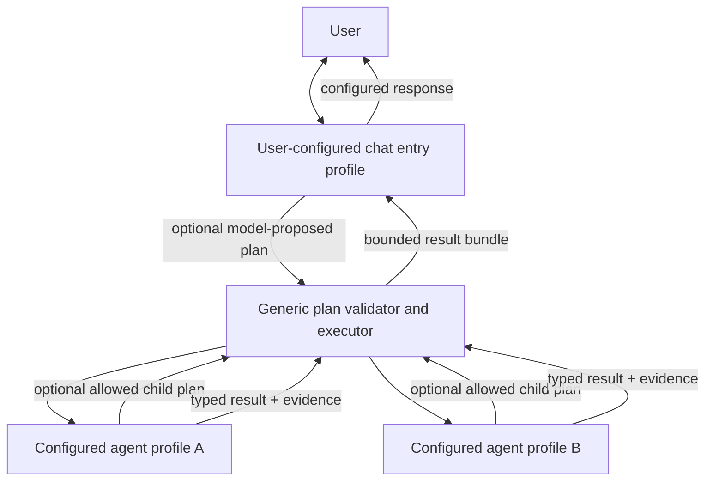

# Self-Directing Hierarchical Agent Orchestration

**Status:** Implemented in-process orchestration; durable executor remains deferred
**Created:** 2026-10-29
**Purpose:** Extend configured specialist delegation into bounded, model-directed teams and user-defined agent topologies
**Audience:** Harness maintainers and product integrators

## 1. Goal

Let agents decide when delegation is useful, choose among user-configured profiles, and coordinate multiple agents for work that needs parallel expertise or staged execution. Let each profile's configuration determine whether it can delegate and to which profiles. The user chooses the chat entry profile, optional planner profile, hierarchy, prompts, capabilities, and delegation policy.

“Self-directing” means a configured model can propose work using the profiles exposed by the user's configuration. The runtime validates and executes that proposal under deterministic capability, depth, concurrency, privacy, and budget rules. It does not mean agents can create privileges, profiles, tools, or unlimited work at runtime. The runtime must not contain product-specific roles such as “director”, “supervisor”, or “worker”; those are optional user-defined names and prompts.

## 2. Current baseline

The harness already has the first layer, delivered in `CONFIGURABLE_AGENT_ORCHESTRATION_PLAN.md`:

- Profiles in `config.yaml` define route, system prompt, tools, skills, handoff targets, and tool-turn limits.
- The main chat can call `agent.delegate`; the selected profile makes a real model call and returns its result to the parent chat.
- `SwarmCoordinator.run_fan_out` can run a caller-selected list in parallel and synthesize results. `run_handoff` supports bounded sequential handoff.
- Unknown profiles fail closed. Profile tools are narrowed by the global allowlist. Mutating or approval-gated tools require an active auto-approval principal.

This is not yet full self-directed orchestration. The model can select one profile by name, but it does not create a validated multi-task plan, select a set of agents from capability metadata, describe dependencies, or recursively delegate. Fan-out is selected by a separate API/CLI call. Profile-level delegation is intentionally disabled. The current handoff protocol also detects a handoff through response text, which is not a reliable typed control signal.

## 3. Proposed architecture: User-Defined Agent Topology

Use a **generic configured-agent graph with bounded model-directed delegation**. The runtime supplies generic agent execution, planning, validation, scheduling, events, and policy enforcement. The configuration supplies the topology and roles. It may describe one conversational agent with direct specialists, a planner with domain managers and workers, a flat peer group, a sequential handoff chain, or a single agent with no delegation. None of those layouts is mandatory or hardcoded.



### Runtime responsibilities versus user configuration

- **Chat entrypoint:** The user selects which profile receives the conversation. It is a configured profile, not a special code class. The product can choose a different entrypoint per application, tenant, workflow, or UI.
- **Optional planner profile:** The user may designate any configured profile to produce task plans. If omitted, the current conversational profile may propose a plan. A separate planner call is optional and policy-controlled, never required by the runtime's topology.
- **Any configured profile:** May answer, plan, delegate, or act as a terminal specialist according to its own explicit configuration. “Supervisor” and “worker” are optional human-readable role labels only.
- **Generic plan validator and executor:** Deterministic runtime code. Validates profile references, configured delegation edges, context references, dependency graph, budgets, and risk policy before starting any child. Schedules eligible tasks sequentially or concurrently and persists status/events. It does not decide business roles or grant permissions.
- **Product response owner:** Usually the configured chat entrypoint, but the host may choose another configured profile or application layer for final synthesis. The runtime returns structured outcomes; it does not hardcode which profile speaks for every product.

`Run owner` in the diagram means the execution identity for the run, not a named agent role. A product may configure a separate planner above a domain supervisor, place them at the same level, or omit either. Planning authority never grants permission authority: no model or hierarchy level can override policy, approval, or tool allowlists.

## 4. Decision model and workflow

1. Host starts a run using the profile named by the configured entrypoint (or explicitly supplied by the host application).
2. That profile receives only the delegation operations enabled by its config. It may answer directly, delegate to one configured target, or ask the generic planner/executor to run a multi-task plan.
3. A planning model sees only eligible configured profile cards: names, descriptions, tags/capabilities, available delegation rights, and limits. The user chooses which metadata is exposed. No credentials or full skill bodies are included in the roster.
4. The configured planning profile—or the current profile when no separate planner is configured—returns a versioned JSON plan: goal, tasks, selected profile per task, task prompt, dependencies, input references, expected output schema, and rationale. It cannot invent profile names or pass arbitrary tool lists.
5. Deterministic validation rejects malformed plans, unauthorized targets, dependency cycles, over-budget plans, and invalid context references before any agent runs. No partial execution occurs on an invalid plan.
6. Executor runs ready tasks. Independent tasks may run concurrently up to the configured cap; dependent tasks wait for declared predecessors. Any profile may submit a child plan if its profile and remaining run budget permit it.
7. Every task returns `succeeded`, `failed`, `blocked`, `cancelled`, or `timed_out`, with bounded output, evidence references, and tool-use summaries. Parents cannot treat failed/blocked children as successful.
8. Executor returns a bounded bundle to the parent profile. The host-selected response owner synthesizes the user-facing answer and distinguishes observed evidence, model conclusions, and missing results.

## 5. Configuration contract proposal

Extend the existing `agents.profiles` schema; do not introduce a second source of truth for roles.

```yaml
orchestration:
  schema_version: 1
  mode: self_directed       # off | single | self_directed | required
  planning_strategy: model_directed # deterministic by default; explicit opt-in for model-created DAGs
  chat_entry_profile: assistan
  planner_profile: task_planner  # optional; omit to let the entry/parent profile plan
  max_depth: 2
  max_total_agents: 8
  max_parallel_agents: 4
  max_plan_tasks: 12
  max_total_tool_calls: 40
  timeout_seconds: 300
  failure_policy: continue_independent  # fail_fast | continue_independen
  context_policy: referenced_only
  result_bytes_per_task: 16000

agents:
  profiles:
    task_planner:
      role: planner              # descriptive metadata; not a hardcoded runtime type
      description: Build dependency-aware plans using configured profiles.
      route: gemini.flash
      system_prompt: ...
      tools: []
      skills: []
      delegation:
        enabled: true
        max_depth: 2
        max_children: 6
        max_parallel_children: 3
        allowed_targets: [engineering_supervisor, researcher, reviewer]
        budget:
          max_tool_calls: 24
          timeout_seconds: 180
    engineering_supervisor:
      role: supervisor           # any role label is allowed; policy controls behavior
      description: Break implementation tasks into reviewable work packages.
      tags: [engineering, planning]
      route: nim.nemotron
      system_prompt: ...
      tools: [file.search_text, file.read_lines]
      skills: [code-investigation]
      delegation:
        enabled: true
        max_children: 3
        allowed_targets: [code_auditor, test_runner, security_auditor]
        allowed_target_tags: [engineering-analysis]
```

### Configuration rules

- `orchestration.mode=off`: no planning/delegation operations exposed. `single`: current one-profile delegation only. `self_directed`: enabled profiles may choose direct work, one delegate, or a validated team plan. `required`: host policy requires a plan before tool actions; the configured planner may return an empty task list for work that needs no agents.
- `orchestration.planning_strategy=deterministic` is the default and withholds `agent.plan`; a host supplies the `TaskPlan` to the deterministic scheduler. `model_directed` explicitly enables LLM-proposed DAGs. `required` is invalid unless `model_directed` is selected. The model can propose topology only within configured eligible profiles; deterministic runtime validation remains mandatory.
- `chat_entry_profile` and optional `planner_profile` are profile IDs chosen by the product operator. `role` is descriptive metadata; it must not trigger hardcoded runtime behavior.
- `delegation.allowed_targets` is the canonical delegation edge list and is intersected with registered profile names. Empty means no child delegation. No implicit “all agents” wildcard in a secure default. The legacy `can_handoff_to` field should migrate to this policy rather than create a second permission list.
- Every profile may set its own delegation policy. User configuration can define arbitrary profile IDs, labels, descriptions, levels, and target relationships. The runtime validates a generic directed graph; it must not require IDs such as `director`, `supervisor`, or `worker`, or a fixed number of layers.
- Candidate discovery uses profile IDs and user-defined tags/capabilities. When both `allowed_targets` and `allowed_target_tags` are configured, eligible profiles must satisfy both filters. The model may dynamically select among eligible candidates; descriptions and tags guide selection but never grant tools. If neither filter is configured, delegation is denied by default.
- The durable planner/executor protocol and non-bypassable safety invariants are runtime-owned. Business roles, prompts, topology, planning strategy, entrypoints, eligible target rules, output requirements, and configured ceilings within global hard limits are user-owned.
- Per-run limits take the minimum of global, profile, principal, and deployment limits. Child tasks inherit remaining—not reset—budgets.
- Unknown keys, route names, skills, tools, targets, output schemas, and invalid limits fail during config validation. Configuration supports an explicit schema version and migration path.
- Static profiles remain operator-owned. Agents may recommend a new profile or skill, but cannot activate it or persist policy changes during a run.

## 6. Planner output contrac

Do not encode routing instructions in prose or parse `HANDOFF:name` strings. Use a typed object validated against a versioned schema:

```json
{
  "schema_version": 1,
  "goal": "Assess the incident and recommend next actions",
  "tasks": [
    {"id":"logs","profile":"log_analyst","task":"Find relevant errors","depends_on":[],"inputs":[]},
    {"id":"runbook","profile":"runbook_researcher","task":"Find matching recovery steps","depends_on":[],"inputs":[]},
    {"id":"synthesis","profile":"incident_supervisor","task":"Compare evidence and recommendations","depends_on":["logs","runbook"],"inputs":["logs.result","runbook.result"]}
  ]
}
```

Validator requirements: unique bounded task IDs; registered/eligible profiles; no self-target unless explicitly allowed; known dependency and result references; acyclic DAG; bounded task/prompt/context sizes; allowed output schema; root goal preserved; limits satisfied. Reject the full plan before execution if invalid. The runtime—not the model—assigns run/task IDs, tenant/principal, permissions, deadlines, and trace metadata.

## 7. Security, trust, and safety invariants

1. **Models propose; runtime disposes.** LLM output is an untrusted plan. Only deterministic validation authorizes task creation or execution.
2. **No permission inheritance by wording.** A child gets only its configured tool list intersected with global allowlist, tenant policy, and current principal permissions. A parent cannot grant extra tools by adding them to a task prompt.
3. **Approval stays with the user/principal.** Agents cannot approve their own or each other’s high-impact tool calls. An approval binds the exact operation, arguments, principal, policy version, and expiry; otherwise the action remains blocked.
4. **Prompt injection stays data.** User content, retrieved pages, tool output, and child output are untrusted data. Use explicit message separation and provenance; never elevate them into system/developer instructions.
5. **Context minimization.** Child tasks receive only explicitly referenced prior outputs and approved context fields, not the entire parent transcript, secrets, memory, or environment by default.
6. **Hard resource bounds.** Enforce hierarchy depth, total tasks, per-profile children, parallelism, model/tool turns, tokens/cost where provider data allows, wall clock, output bytes, and tool calls cumulatively across the run.
7. **Cancellation and failure propagation.** User cancellation stops scheduling new work and signals active tasks. Parent synthesis reports partial results and failed/cancelled tasks accurately.
8. **Isolation claims are explicit.** Delegation is logical isolation. OS/container/network isolation remains the configured tool executor’s responsibility.
9. **No hidden side effects in planning.** Planning calls have no tools. A task can execute only after the plan passes validation and policy checks.

## 8. Runtime API and events

Add a run-scoped orchestration interface to `AgentHarness`, preserving current `agent.delegate` for compatibility:

- `plan(task, context_refs, policy) -> PlanProposal`
- `validate_plan(proposal, run_context) -> ValidatedPlan | PlanRejection`
- `execute_plan(validated_plan, event_sink, cancellation) -> OrchestrationResult`
- Async equivalents usable inside existing event loops; no nested `asyncio.run`.
- `StreamEvent` additions: `plan_proposed`, `plan_validated`, `task_queued`, `task_started`, `task_progress`, `task_completed`, `task_failed`, `plan_cancelled`, and `orchestration_completed`. Each event carries run/task/parent IDs and bounded metadata; never raw secrets or unrestricted prompts.

The executor should be pluggable behind a small protocol (in-process first; durable worker backend later). Chat UI, REST/SSE/WebSocket, and SDK subscribe to the same event contract. A product can render a task tree without depending on swarm internals. Event types are a stable runtime protocol; payload fields and product-specific presentation remain extensible through versioned metadata.

## 9. State and lifecycle

Persist an orchestration run with immutable plan snapshot, profile/config fingerprints, parent task relationships, status, deadlines, remaining budgets, and event cursor. Each task has a unique idempotency key to prevent duplicate side effects on retry. Store redacted/bounded prompts and result references according to configured retention; sensitive input needs an explicit storage policy. A worker restart must not silently re-run a non-idempotent tool action.

Initial implementation may execute in-process and clearly label itself non-durable. The storage schema and executor protocol should allow a separate durable worker queue later without changing profile configuration or client APIs.

## 10. Product examples

### Software engineering reques

User: “Investigate why checkout tests are flaky and recommend a fix.” The product configures a chat entry profile and a planning profile; these may be the same agent. The planner can run a test specialist and code investigator concurrently; a reviewer depends on both. No agent writes code unless its profile and the active approval policy permit it. The configured response owner returns evidence, likely cause, and tests actually run.

### Support case

The configured support profile may delegate to an account lookup profile and a policy lookup profile in parallel. A refund action remains blocked until the authenticated user approves that exact action. Child agents never see unrelated customer history.

### Research task

The configured planner assigns multiple source-finding tasks in parallel and a claim/evidence reviewer after them. Retrieved text is untrusted; every claim has source references and validation status. The configured response owner reports unsupported claims and uncertainty.

### Simple question

The entry profile answers directly without invoking a separate planner or any specialists. The design must not require a swarm for every request or claim that multiple agents inherently improve quality.

## 11. Implementation phases and gates

### Phase 0 — Contract and compatibility

Create a versioned schema, typed plan/result/event models, and migration behavior. Keep the current configured single-delegate feature working. Document the distinction between logical hierarchy and OS isolation.

**Gate:** old config loads unchanged; invalid new config fails with path-specific errors; no policy/tool permission is broadened.

### Phase 1 — Self-selection of one profile

Expose eligible configured profile cards and delegation-policy settings to the selected entry profile. Allow the model to decide direct answer vs one configured specialist. Enforce target sets, context projection, status propagation, and event correlation. This phase converts current profile-name choice into capability-aware choice while staying one child deep.

**Gate:** evaluations show suitable delegation, direct-answer restraint, correct profile selection, and no unknown profile execution.

### Phase 2 — Validated multi-agent plans

Add optional configured planner profile behavior, JSON plan parsing, DAG validation, deterministic scheduler, bounded fan-out, dependency passing, partial failure, cancellation, and merged result bundle. Keep planning tool-free. If no separate planner is configured, an eligible parent profile may submit the plan.

**Gate:** plans with cycles, unknown targets, invalid references, over-budget counts, or unauthorized capabilities execute zero children.

### Phase 3 — Configurable hierarchy

Enable any profile configured for delegation to create child plans within remaining depth/child/budget allowances. Carry run ID, parent task ID, tenant/principal, policy version, trace context, cancellation, and budget through every descendant. Detect cycles in delegation targets and runtime task ancestry.

**Gate:** adversarial nested plans cannot exceed configured total resources or escape allowed-target sets; child outputs remain scoped to their parent.

### Phase 4 — Product adapters and durable execution

Expose stable async SDK/service event interfaces and executor protocol. Add durable queue/recovery only after idempotent action records, cancellation, retention, tenant isolation, and worker identity are implemented and tested.

**Gate:** restart and retry tests demonstrate no duplicate side effects; API and embedded SDK produce equivalent results/events; production deployment profile passes security review.

## 12. Evaluation and test plan

Maintain deterministic local tests plus provider-backed quality evals separately.

- **Selection:** trivial task stays direct; specialist tasks select right role; missing capability asks/returns limitation instead of inventing an agent.
- **Planning:** valid plans execute; malformed JSON, unknown profile/tool, cycles, duplicate IDs, invalid dependencies, and unsupported output schema launch zero tasks.
- **Hierarchy:** nesting respects depth, child count, aggregate calls, token/cost budget, timeouts, target edges, and cancellation.
- **Security:** prompt injection in user/retrieved/child results; cross-tenant context references; unauthorized tool call; approval spoofing; secret exfiltration attempts; malicious profile names.
- **Reliability:** provider/tool errors, one child timeout, sibling completion, retries, duplicate task delivery, cancellation race, worker restart, and partial synthesis.
- **Quality:** compare single-agent baseline with dynamic delegation on task success, factual/evidence quality, policy violations, latency, and cost. More agents is not presumed better.
- **Observability:** all task events correlate to a run and parent; no raw credential, unrestricted prompt, or private unrelated context in event payloads.

## 13. Risks and explicit non-goals

- **Cost/latency:** Dynamic plans can multiply model calls. Start with strict conservative defaults; make configured maxima visible before execution where possible.
- **Planner fragility:** The plan model can choose a poor decomposition. Keep plans simple, validate deterministically, and evaluate against direct-agent baselines.
- **Untrusted agents:** Every model output is untrusted. Validation prevents unauthorized execution but cannot guarantee semantic correctness.
- **Concurrency:** Shared tool registries may not make every third-party tool thread-safe. Require declared concurrency safety or serialize that tool.
- **Durability:** In-process task execution is not a durable queue. Phase 4 is a separate release gate.
- **No “arbitrary action” promise:** The system can only use configured integrations and permissions. It is not a self-authorizing agent or a substitute for product security controls.

## 14. Revision and implementation handoff

- **Draft 1:** Proposed a Director → supervisor → worker hierarchy and dynamic DAG scheduling.
- **Review pass 1:** Added deterministic plan validation before side effects, capability intersection, approval authority, prompt-injection boundaries, minimal context, cumulative budgets, and explicit cancellation/error semantics.
- **Review pass 2:** Compared the plan with current `SwarmCoordinator`, `AgentHarness`, configured profiles, tool registry, and sync/async SDK. Preserved the completed single-profile delegation as Phase 1 compatibility; kept durable workers and OS isolation out of scope until their required foundations exist.
- **User correction and review pass 3:** The named hierarchy could be read as hardcoded product roles. Reframed the design as a generic configured profile graph: chat entrypoint, optional planner, agent labels, target edges, and levels all come from user configuration. The Director/supervisor/worker names remain only illustrative examples. Added this as a binding architecture rule and removed duplicate delegation-target configuration from the proposed schema.
- **Implementation state (2026-10-29):** Phases 0–3 are implemented in-process: startup-validated profiles and delegation targets, model-proposed plan validation, DAG scheduling with independent-task concurrency, nested planning, shared run budgets, cancellation/deadline checks, bounded inputs/results, and run-correlated task events. Deterministic planning is the default; model-created plans require explicit opt-in. Tool scope is checked at execution as well as model-catalog construction. A child timeout is local to that task so independent siblings can complete. Phase 4 durability, restart recovery, and exactly-once external side effects are not implemented and must remain a separate gated release.
- **Structured-output reliability:** Planner output parsing accepts one bounded, unambiguous plan object even with common Markdown/prose wrappers, and makes a finite format-only retry. The same safe extraction is shared with the graph router and research synthesis; no consumer repairs missing plan structure or bypasses its domain-specific validation.

## 15. References in this repository

- `docs/CONFIGURABLE_AGENT_ORCHESTRATION_PLAN.md` — implemented single-specialist baseline and verification record.
- `docs/SELF_DIRECTING_HIERARCHICAL_ORCHESTRATION_PLAN.md` — this proposed next architecture and phased build plan.
- `harness/swarm.py` — profile loading, single-agent execution, explicit fan-out and handoff.
- `harness/sdk.py` — main chat loop, SDK streams, and swarm entrypoint.
- `harness/registries/tool_registry.py` — profile delegation tool boundary and tool policy.
- `harness/cli.py` — CLI chat and explicit swarm command.
- `tests/test_agent_profiles.py`, `tests/test_tier1_sdk.py`, `tests/test_phase3_graphs_and_swarms.py` — current single-profile and swarm coverage.

- 2026-10-29 critical implementation follow-up: Added explicit planning_strategy selection with deterministic planning as the default and model-directed DAG generation as an opt-in. Hardened conversational tool invocation so a model cannot bypass the entry profile's scope by naming a globally registered tool. Direct child delegation now validates and forwards bounded context. Fixed child timeout handling so one timed-out task does not cancel independent siblings. Added tests for true parallel overlap, sibling completion after timeout, and profile-scope bypass.

- 2026-10-29 final verification: uv run pytest -q tests/test_agent_profiles.py tests/test_tier1_sdk.py tests/test_phase3_graphs_and_swarms.py tests/test_cli.py passed (66 tests). uv run pytest -q passed (216 tests and 12 subtests). uv run ruff check harness tests, uv run python -m compileall -q harness, git diff --check, and uv build passed; the build produced the source archive and wheel. git diff --check reported only the repository's expected LF-to-CRLF working-copy notices.

- 2026-10-29 sample-config check: direct load_config plus SwarmCoordinator.from_default_config succeeded and resolved self_directed / model_directed / assistant with the five configured profiles. The separate uv run ivy tools command was attempted but failed because that CLI subcommand queries the local API at 127.0.0.1:8000 and no server was running; it did not validate config and is not counted as a successful check.
